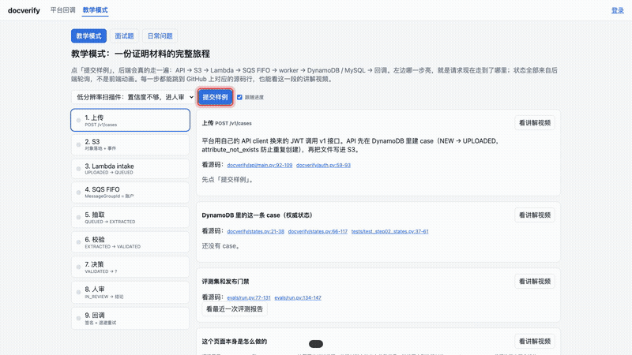
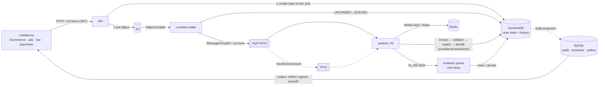

# docverify

**A document-verification workflow backend: platforms submit business evidence, the pipeline extracts and checks it against account records, uncertain results go to a human, and signed callbacks report the outcome — and no duplicate, crash or timeout ever processes a case twice.**



▶ 中文讲解视频（每个阶段一段）：[docs/videos/](docs/videos/) · 日常问题讲解：[docs/videos/problems/](docs/videos/problems/) ·
📖 [分章教程](docs/tutorial/README.md) · 🎯 [面试题](docs/interview.md) · 🛠 [日常问题与解决](docs/problems.md)

Everything runs locally with one command, no AWS account and no API keys: S3, SQS FIFO, Lambda and DynamoDB are
LocalStack 4.9 (the intake Lambda really runs in a Lambda container), plus MySQL 8.4 and Redis 7.

## What it does



| stage | contract | what decides it |
|---|---|---|
| upload | `POST /v1/cases` (multipart) → `{case_id, state}` | platform JWT; account must belong to the platform |
| intake | S3 `ObjectCreated` → Lambda → SQS FIFO | `MessageGroupId = account_id`, `MessageDeduplicationId = case-round` |
| extraction | `Extractor.extract(bytes, type) → fields with confidence` | Tesseract OCR / PDF text layer, swappable for a model |
| validation | list of checks: schema · deterministic rules · confidence thresholds | Luhn check digit, expiry, jurisdiction, per-field thresholds |
| decision | `APPROVED` / `REJECTED` / `IN_REVIEW` / `RESUBMIT_REQUESTED` | see the policy below |
| human review | `POST /v1/review/claim`, `POST /v1/review/cases/{id}/decision` | min-heap on `enqueued_at − 60s × risk`; claim is a conditional write |
| callback | `PUT /v1/webhooks`; `case.status_changed` events | outbox + `t=…,v1=HMAC-SHA256` signature + exponential backoff |

**The decision policy — uncertain AI output never decides account status alone.** Auto-approve only when every
schema, rule and confidence check passed and name and address match the account; auto-reject only on a
deterministic rule failure read at ≥ 0.90 confidence (bad check digit, expired); everything else goes to a person
with a risk score. A hypothesis property test (500 random check/match combinations) pins this down.

## Run it

```bash
./scripts/demo.sh      # needs docker-compose, Python 3.11, Node 20+, tesseract (brew/apt)
```

Then open http://127.0.0.1:5501/learn and press **提交样例**. Demo identities (obvious placeholders, created only with
`DOCVERIFY_SEED_DEMO=1`): platforms `<platform>-demo` / `demo-secret-<platform>`, reviewer `reviewer` / `reviewer-demo-pass`.

| | |
|---|---|
| frontend (React + TS) | http://127.0.0.1:5501 — submit, cases, review queue, callbacks, **/learn**, **/learn/interview** |
| API (FastAPI) | http://127.0.0.1:8501/docs |
| mock platform receiver | http://127.0.0.1:8511/received |

Tests (the stack's containers must be up: `docker-compose up -d`):

```bash
.venv/bin/pytest                         # 38 tests against real LocalStack / MySQL / Redis (~4 min)
./scripts/failure_controls.sh            # the same tests with each protection switched off (~12 min)
.venv/bin/python -m evals.run            # evaluation set + release gate
cd e2e && npx playwright test            # UI end-to-end, needs ./scripts/demo.sh running
node scripts/check_anchors.mjs           # learn-page source links still point at the right lines
```

## Why these choices

- **DynamoDB conditional writes for state, MySQL for audit.** A transition commits only if the item is still in the
  `from` state for the same round; the same write appends to the item's own `history` with a unique `write_id`.
  There is no transaction across the two stores, so DynamoDB's history is authoritative and `audit_log` is a
  projection that `reconcile()` back-fills after a crash between the two writes.
- **SQS FIFO grouped by account.** One account's documents are processed strictly in order; different accounts in
  parallel; workers scale horizontally. FIFO's own dedup only covers five minutes, hence the next point.
- **Redis is a work-saver, the conditional write is the guarantee.** `done:` keys drop finished duplicates; a `lock:`
  lease stops a concurrent copy from redoing OCR. A lease can expire under a paused worker — then two workers really
  run the same stage, and only the conditional write keeps one commit. The failure controls show both halves.
- **Outbox for callbacks.** Status changes write a row unique per (case, round, status); a dispatcher using
  `FOR UPDATE SKIP LOCKED` delivers it with a timestamped HMAC signature (replay-safe) and the same event id on every
  retry (receivers dedupe).
- **Create the case before the object.** The object's arrival fires the Lambda, so the case must already exist.
- **A heap key that never changes.** Priority `risk × 60s + waited` orders the same as `enqueued_at − 60·risk`,
  because every case ages at the same rate — so the key is computed once, at push.
- **Matching written from scratch** (normalisation, Levenshtein, token-set, alias index keyed by name *and* legal
  suffix) so every rule is visible and property-tested.

## Tests, and proof that they can fail

Each protection has a test-only switch; `scripts/failure_controls.sh` turns them off one at a time and reruns the
correctness tests (`tests/test_step02_states.py`, `tests/test_step06_chaos.py`). Measured
(raw output in [docs/results/failure_controls.raw.txt](docs/results/failure_controls.raw.txt)):

| protection switched off | tests that go red |
|---|---|
| none | none — 10 passed |
| DynamoDB conditional writes | concurrent decisions (**20 of 20 threads "succeed"**), stale-state conflict, lock-expiring-mid-extraction (every stage committed twice) |
| Redis dedup | concurrent copies redo extraction (OCR ran twice for one document) |
| both | all of the above, plus the full chaos run |

The chaos run: 5 workers, 16 genuine documents each replayed twice, extraction taking 0.2–8 s against a 6 s
visibility timeout, a worker SIGKILLed about once a second for 20 s. Asserted: every `(case, round, from, to)`
appears exactly once in the audit log, history and audit agree, and **every document ends APPROVED** (none
dead-lettered). The lock-expiry scenario first asserts that concurrent copies really happened, so it cannot pass
vacuously.

Also: a hypothesis property test of the decision policy (500 cases), Levenshtein metric laws, per-account FIFO
ordering, poison message → DLQ after `maxReceiveCount`, callback retries `503, 503, 200` with one event id and a
valid signature each time, platform isolation (another platform's case is a 404), and two reviewers never
claiming the same case. UI: 5 Playwright tests covering both user flows, learn mode, interview and problems tabs.

Ten real problems hit while building this — symptom, how it was located, the fix, the test that proves it — are in
[docs/problems.md](docs/problems.md), each with a line-by-line video.

## Evaluation (measured in this repo, on synthetic documents)

`python -m evals.run` builds 147 labelled documents (12 accounts × clean / poor quality / altered / unsupported
format / name variants) and runs the real OCR → validation → matching → decision on them. The gate
([evals/thresholds.json](evals/thresholds.json)) requires zero incorrect auto-approvals, a minimum accuracy per
category, and at most a 0.25 gap in auto-approval rate between name-origin groups.

| category | n | decision accuracy | incorrect auto-approvals | auto-approve rate |
|---|---|---|---|---|
| clean | 24 | 100.0% | 0 | 100.0% |
| poor_quality | 48 | 100.0% | 0 | 0.0% |
| altered | 48 | 100.0% | 0 | 0.0% |
| unsupported_format | 15 | 100.0% | 0 | 0.0% |
| demographic | 12 | 100.0% | 0 | 100.0% |

- Readable genuine documents auto-approved: **100.0%** with the full matcher vs
  **55.6%** with naive exact name matching (`--matcher exact`), same rejection rules, zero
  incorrect auto-approvals either way.
- **The gate failed on its first run**: Spanish and Danish names auto-approved at 67% vs 100% for the rest — the
  English OCR model read "Søren" as "Seren" at 0.40 confidence. Fixed by adding Tesseract's Latin-script model and
  transliterating ø/æ/ß, not by lowering a threshold ([chapter 10](docs/tutorial/10-evaluation.md)).
- These are synthetic documents built to exercise known variations. They show the mechanisms work; they are not a
  real-world accuracy number.

## Teaching mode

`/learn` submits a sample and lights up each stage as the backend reaches it — status comes from polling the real
stores, not an animation — with that stage's real data beside it (S3 metadata, the Lambda's CloudWatch log line,
the SQS receipt with its message group, the DynamoDB history, the signed callback and the receiver's verdict) and
links to the code on GitHub, pinned to the build's commit. Line numbers are never hand-written: `@learn:<id>` …
`@learn:end <id>` comments are scanned into `anchors.json`, and `check_anchors.mjs` fails CI if one drifts.
Each stage has its own short narrated video. The [tutorial](docs/tutorial/README.md) rebuilds the project in ten
steps, one git tag each (`step-01` … `step-10`).

## What this is not

- Not production-hardened: no metrics/tracing, secrets come from env vars, the review heap lives in one API
  process (claims stay correct across instances because they are conditional writes, but ordering is per instance),
  the sweeper and refresher use DynamoDB `Scan`.
- The extractor is Tesseract plus label rules on synthetic documents. Real evidence (photos of paper, stamps,
  multi-page PDFs) needs a real layout model; the `Extractor` interface is where it plugs in.
- The callback outbox is not yet reconciled from DynamoDB history (the audit log is).
- The numbers on the author's résumé come from a production system; none of them are claimed by this repository.

## Layout

```
docverify/        API (api/main.py), worker, states, extract, validate, match, decide, review, callbacks, learn
lambdas/intake/   the S3-triggered intake Lambda
mockplatform/     stand-in for the four business platforms (verifies signatures)
evals/            evaluation set, thresholds, latest report
frontend/         React + Vite + TypeScript (learn mode, interview tab)
e2e/              Playwright UI tests
video/            learn-mode recording script, narration, parts
docs/             tutorial/, interview.md, videos/
```

MIT licensed.
